# ISA School Visit Scheduling System

A React Native application for managing school visit schedules, administrative approvals, location monitoring, and visit reports within an educational administration structure.

The system provides role-based access for In-Service Advisors (ISAs), Assistant Directors of Education (ADEs), Deputy Directors of Education (DDEs), Zonal Directors of Education (ZDEs), and administrators. It is designed to replace fragmented and manual processes with a centralized workflow for scheduling and monitoring school visits.

<p align="center">
  
  
  
  
  
  
  
  
</p>

## Table of Contents

- [Overview](#overview)
- [Live Application](#live-application)
- [Demo Accounts](#demo-accounts)
- [Features](#features)
- [User Roles](#user-roles)
- [Application Screenshots](#application-screenshots)
- [System Architecture](#system-architecture)
- [Technology Stack](#technology-stack)
- [API Reference](#api-reference)
- [Authentication and Authorization](#authentication-and-authorization)
- [Project Structure](#project-structure)
- [Run Locally](#run-locally)
- [Environment Variables](#environment-variables)
- [Deployment](#deployment)
- [Security Notes](#security-notes)
- [Future Enhancements](#future-enhancements)
- [Author](#author)

## Overview

School visits are an important part of educational monitoring and support. Managing visit schedules, revisions, approvals, and reports manually can make it difficult to follow the progress of requests and maintain consistent records.

The ISA School Visit Scheduling System provides a web-accessible interface and backend API to support these activities. ISAs can manage and submit monthly visit schedules, while authorized education officers can review schedules, approve or reject them, monitor visits by ISA or location, and generate reports.

### Project Objectives

- Digitize school visit scheduling and monthly submission.
- Support role-based access for educational officers and administrators.
- Provide a structured schedule review and approval process.
- Allow schedule revision requests and show recent rejection information to ISAs.
- Support monitoring by ISA and location.
- Provide location management for authorized administrators.
- Support monitoring report submission and visit PDF generation.
- Deploy the frontend, backend, and database using cloud infrastructure.

## Live Application

| Component | Details |
|---|---|
| Web Application | [Open the Live Application](https://isa-school-visit-scheduling-system-one.vercel.app) |
| Backend API | [Backend API](https://isa-vsm.duckdns.org) |
| Frontend Hosting | Vercel |
| Backend Hosting | AWS EC2 |
| Reverse Proxy | NGINX |
| Database | MySQL hosted on Aiven |
| Source Code | [GitHub Repository](https://github.com/hadhi419/ISA-School-Visit-Scheduling-System) |

The application is deployed and accessible online.

### Accessing the Application

1. Open the Vercel application link.
2. Wait for the application to load.
3. Sign in using one of the available demo accounts below.
4. Explore the features available for that particular user role.

## Demo Accounts

The following accounts are provided to allow visitors, recruiters, and developers to explore the role-based functionality of the application.

| Role | Email | Password |
|---|---|---|
| ISA | `isa.testuser@gmail.com` | `Abc@abc123` |
| ADE | `ade.testuser@gmail.com` | `Abc@abc123` |
| DDE | `dde.testuser@gmail.com` | `Abc@abc123` |
| ZDE | `zde.testuser@gmail.com` | `Abc@abc123` |

**Demo account guidelines**

- These accounts are provided for demonstration and testing purposes.
- Please avoid entering real personal or confidential information.
- Some actions may modify shared demonstration data.
- Please do not change demo account passwords.
- If an account becomes unavailable, the demonstration environment may be temporarily undergoing maintenance.

## Features

### ISA Features

- View the ISA dashboard and alerts.
- Manage monthly school visit entries.
- Check whether a monthly schedule can be edited.
- Submit monthly visit schedules for review.
- View advanced programs in calendar and card layouts.
- Filter advanced program cards.
- Submit monitoring reports with file attachments.
- View the latest schedule rejection information.

### ADE and DDE Features

- View the administrative dashboard.
- Retrieve submitted visit schedules.
- View visit details for an ISA.
- Approve or reject schedules according to the user's role.
- Request schedule revisions through the applicable workflow.
- Monitor visits by ISA and location.
- Access report-generation functionality.

### ZDE Features

- Access the ZDE dashboard.
- View submitted schedules and visit details.
- Monitor visit information by ISA and location.
- Access report-generation functionality.

Note: ZDE approve/reject endpoints are commented out in the supplied approval router and are not listed as active API operations.

### Administrator Features

- Register users through the available registration endpoint.
- Retrieve all users.
- Edit user information.
- Change passwords.
- Add and edit school/location records.

Note: Currently not available for demo users

### General Capabilities

- JWT authentication middleware on protected route groups.
- Role-based authorization on protected endpoints.
- Centralized MySQL persistence.
- REST API communication between frontend and backend.
- Visit PDF generation endpoint.
- Monitoring report submission with up to five uploaded files per request.

## User Roles

| Role | Capabilities exposed by the supplied routes |
|---|---|
| `ISA` | Manage and submit own monthly visits, check edit permission, delete visit entries, view latest rejection information, submit monitoring reports |
| `ADE` | View submitted schedules and visit details, approve/reject schedules, monitor by ISA/location, access visit PDF route |
| `DDE` | View submitted schedules and visit details, approve/reject schedules, monitor by ISA/location, access visit PDF route |
| `ZDE` | View submitted schedules and visit details, monitor by ISA/location, access visit PDF route |
| `ADMIN` | Manage users and locations, change passwords |

The exact data-level permissions depend on the controller logic as well as route middleware.

## Application Screenshots

Screenshots are stored in the [`screenshots/`](screenshots/) directory.

### ISA Dashboard

<p align="center">
  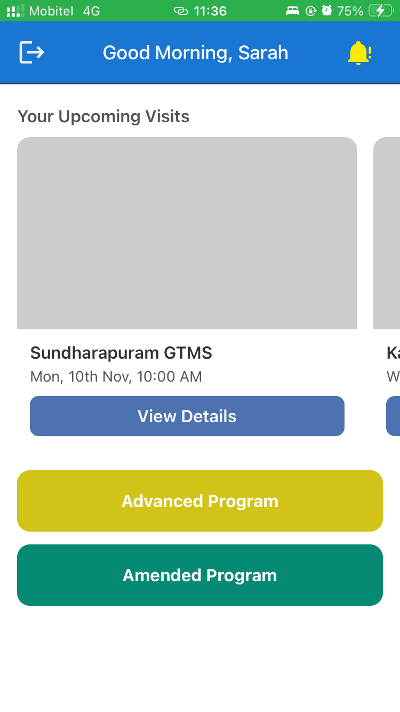
  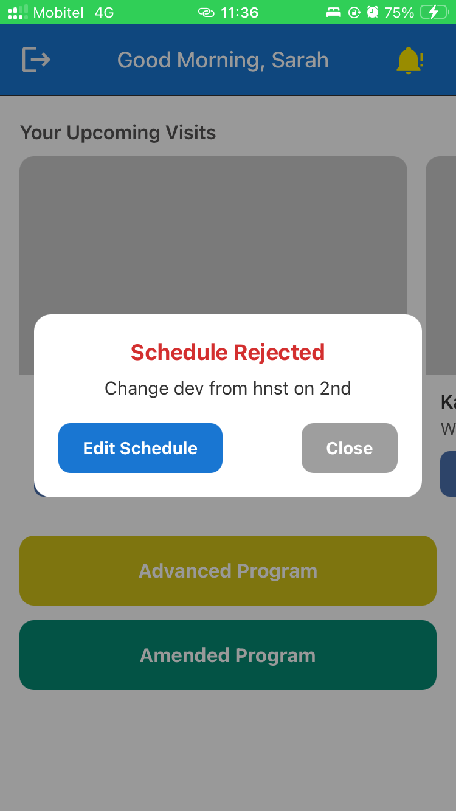
</p>

### Advanced Program Scheduling

**Calendar View**

<p align="center">
  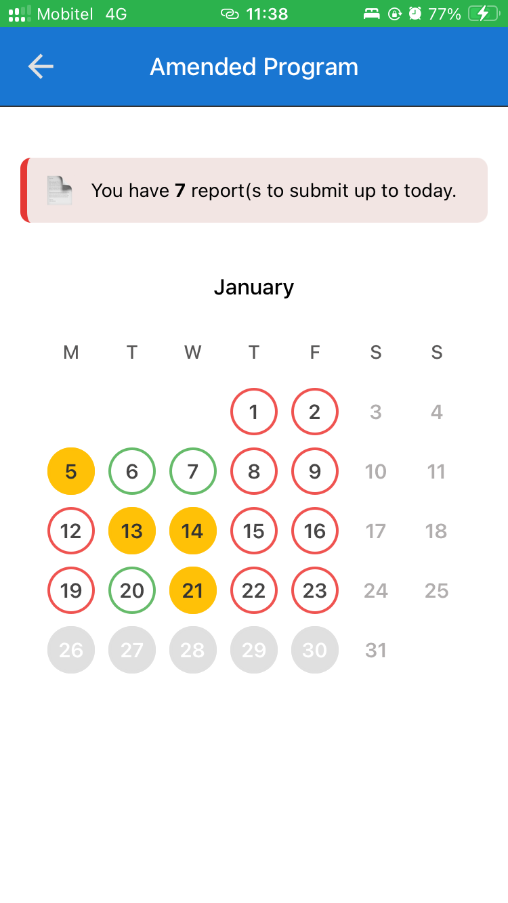
</p>

**Card View and Filters**

<p align="center">
  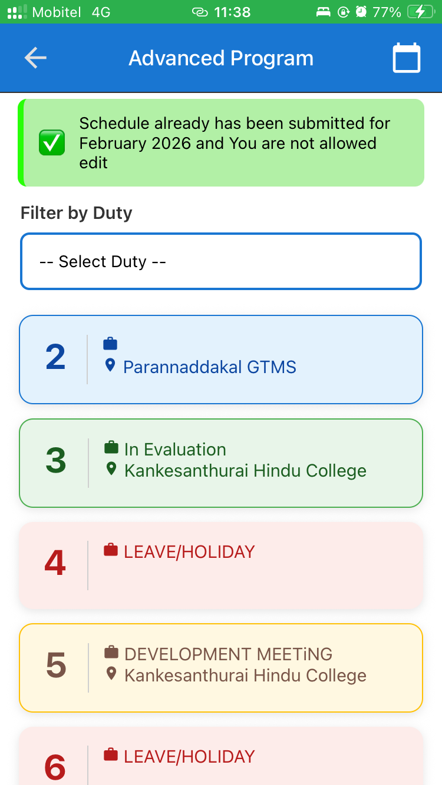
  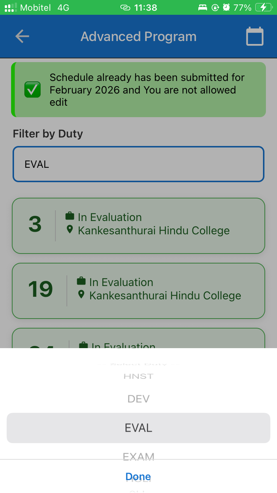
  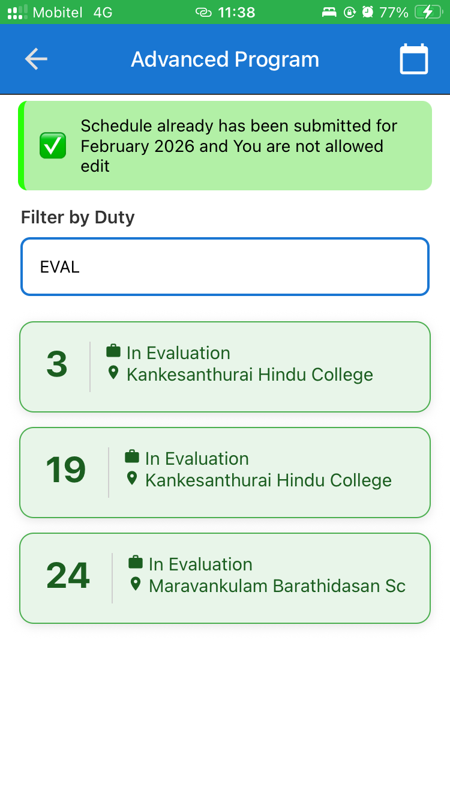
</p>

### Monitoring Report Submission

<p align="center">
  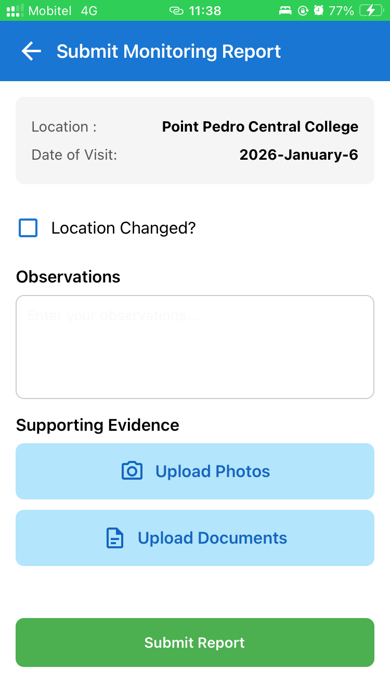
  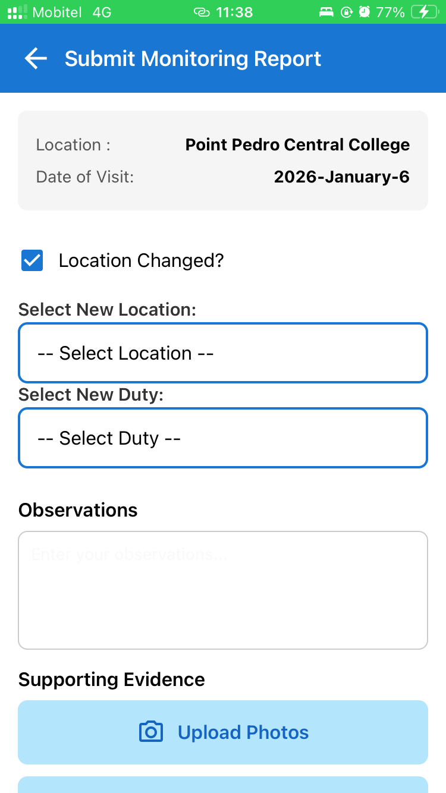
</p>

### ADE and DDE Dashboard

<p align="center">
  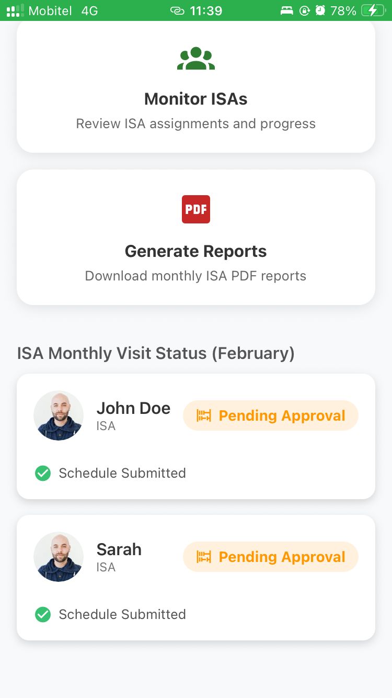
</p>

### Schedule Review and Revision Request

<p align="center">
  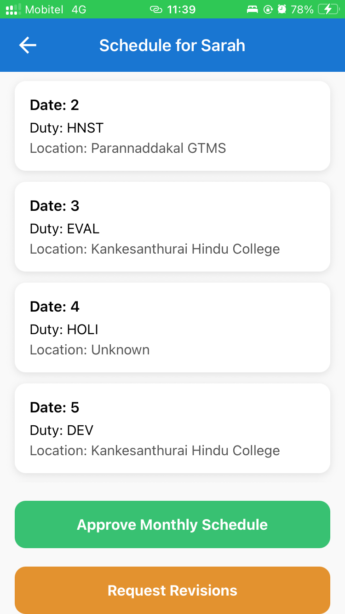
  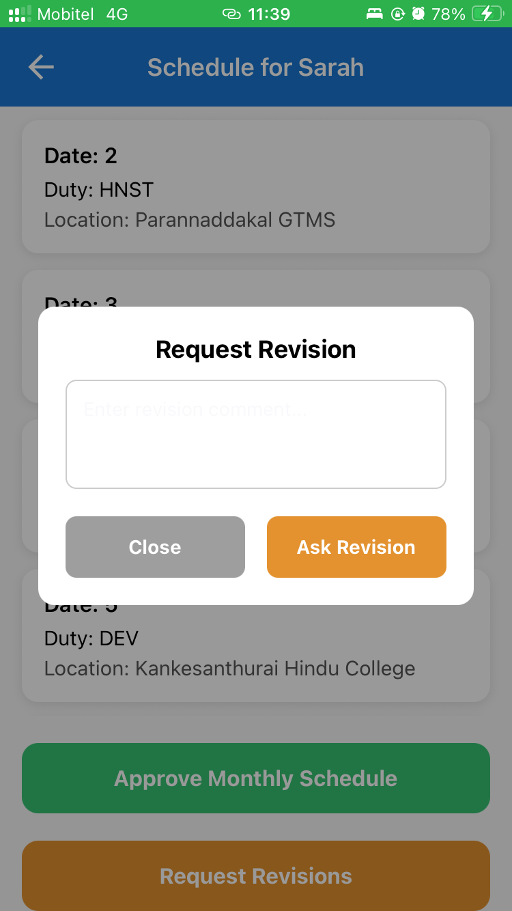
</p>

### Location Monitoring

<p align="center">
  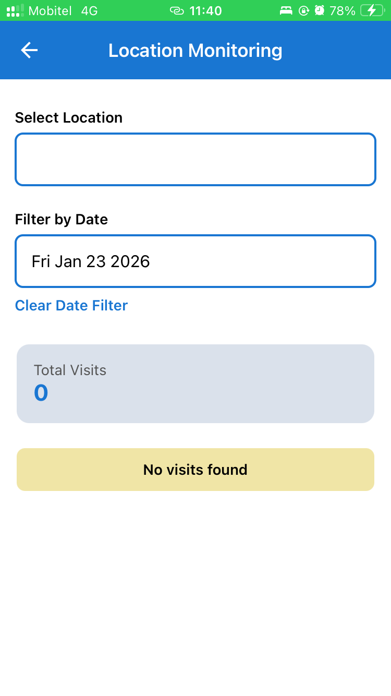
</p>

### Report Generation

<p align="center">
  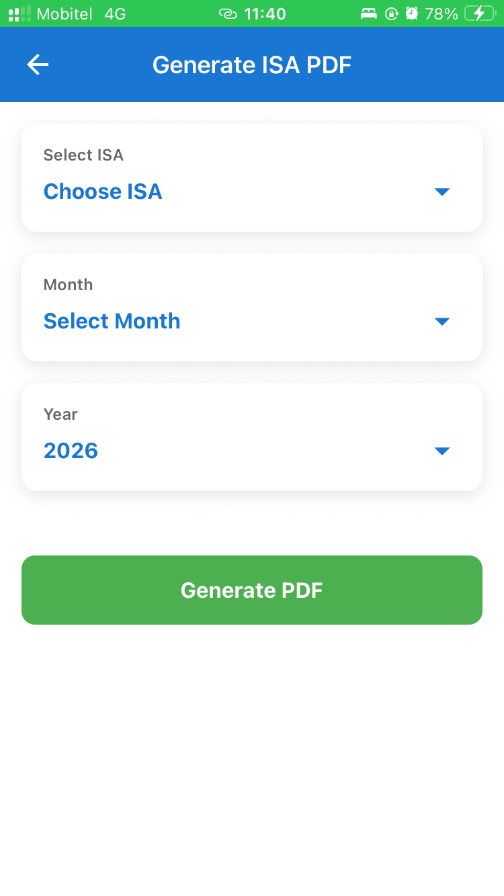
</p>

### ZDE Dashboard

<p align="center">
  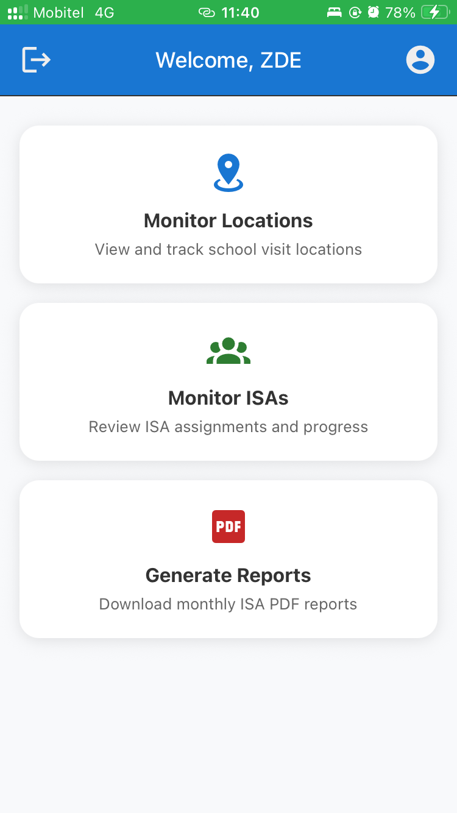
</p>

## System Architecture

The system follows a client-server architecture with separately deployed frontend, backend, and database components.

```text
       User's Web Browser
                |
                | HTTPS
                v
+----------------------------------+
|         Vercel Hosting           |
|       React Native Web           |
+----------------------------------+
                |
                | HTTPS / REST API
                v
+----------------------------------+
|          AWS EC2                 |
|                                  |
|            NGINX                 |
|        Reverse Proxy             |
|                |                 |
|                v                 |
|       Node.js + Express          |
|                                  |
|  Authentication and Authorization|
|  Visits, Approvals, Locations    |
|  Reports and PDF Generation      |
+----------------------------------+
                |
                | Secure MySQL Connection
                v
+----------------------------------+
|          Aiven MySQL             |
|      Managed Database            |
+----------------------------------+
```

### Architecture Components

**Frontend - React Native Web**

The React Native frontend is exported for web and deployed on Vercel. It provides the user interface, navigation, forms, and role-specific screens.

**Backend - Node.js and Express.js**

The backend provides REST API endpoints for authentication, visit management, approvals, location data, reporting, and PDF generation.

**Reverse Proxy - NGINX**

NGINX is configured as a reverse proxy on the AWS EC2 server. It receives incoming HTTP/HTTPS requests and forwards API requests to the Node.js backend service.

**Cloud Infrastructure - AWS EC2**

The Express backend runs on an AWS EC2 virtual machine, making the API accessible to external clients.

**Database - Aiven MySQL**

Aiven hosts the managed MySQL database, which stores the application's structured data.

## Technology Stack

| Layer | Technology |
|---|---|
| Frontend | React Native |
| Web Export | React Native Web / Expo web configuration, as applicable |
| Backend Runtime | Node.js |
| Backend Framework | Express.js |
| API Style | REST |
| Authentication | JWT-based middleware |
| Authorization | Role-based middleware |
| Database | MySQL |
| Frontend Deployment | Vercel |
| Cloud Infrastructure | AWS EC2 |
| Reverse Proxy | NGINX |
| Database Hosting | Aiven |
| Version Control | Git and GitHub |

## API Reference

The endpoints below are based on the supplied Express router definitions.

The router-relative path is shown because the final URL prefix depends on how each router is mounted in the main server file. Confirm the mount prefixes in `server.js` or `app.js` before treating the full URLs as final.

### Authentication and User Management

| Method | Path | Purpose | Access |
|---|---|---|---|
| `POST` | `/register` | Register a user | Public |
| `POST` | `/login` | Authenticate a user | Public |
| `GET` | `/allUsers` | Retrieve all users | Authenticated ADMIN |
| `POST` | `/editUser` | Edit user information | Authenticated ADMIN |
| `POST` | `/change-password` | Change password | ADMIN, ISA, DDE, ADE, ZDE |

### Schedule Approvals

The approval router applies `authenticate` to all routes.

| Method | Path | Purpose | Allowed Role |
|---|---|---|---|
| `GET` | `/` | Fetch submitted visit schedules | ZDE, DDE, ADE |
| `GET` | `/visitDetail/:isa_id` | Fetch visit details for an ISA | ZDE, DDE, ADE |
| `POST` | `/dde/approve/:isa_id` | Approve a schedule through the DDE route | DDE |
| `POST` | `/dde/reject/:isa_id` | Reject a schedule through the DDE route | DDE |
| `POST` | `/ade/approve/:isa_id` | Approve a schedule through the ADE route | ADE |
| `POST` | `/ade/reject/:isa_id` | Reject a schedule through the ADE route | ADE |
| `GET` | `/rejections/latest/:isa_id` | Retrieve the latest rejection for an ISA | ISA |

ZDE approve/reject routes are commented out in the supplied router and are not active endpoints.

### Locations

The location router applies `authenticate` to all routes.

| Method | Path | Purpose | Allowed Role |
|---|---|---|---|
| `GET` | `/` | Fetch locations | ISA, DDE, ZDE, ADE, ADMIN |
| `POST` | `/addLocation` | Add a location | ADMIN |
| `POST` | `/edit` | Edit a location | ADMIN |

### Monitoring Reports

| Method | Path | Purpose | Middleware visible in supplied router |
|---|---|---|---|
| `POST` | `/submit` | Submit a monitoring report with up to five files | `upload.array('files', 5)` |

**Security note:** The supplied report router does not show authentication or role-authorization middleware. Confirm whether these checks are enforced inside the controller or at a higher level.

### Visit PDF

| Method | Path | Purpose |
|---|---|---|
| `POST` | `/pdf` | Generate a visit PDF |

The supplied router applies authentication, but the controller is placed before the role-authorization middleware. Review this middleware order to ensure authorization occurs before PDF generation.

### Visits

The visits router applies `authenticate` to all routes.

| Method | Path | Purpose | Allowed Role |
|---|---|---|---|
| `POST` | `/` | Create/post multiple visit entries | ISA |
| `POST` | `/delete` | Delete a visit entry | ISA |
| `GET` | `/month/:month/:isa_id` | Fetch visits for an ISA and month | ISA |
| `GET` | `/month/:month/:isa_id/edit-permission` | Check monthly edit permission | ISA |
| `POST` | `/submit` | Submit monthly visits | ISA |
| `GET` | `/isa` | Monitor visits by ISA | ZDE, DDE, ADE |
| `GET` | `/isaDetails` | Fetch ISA details/list | ZDE, DDE, ADE |
| `GET` | `/location` | Monitor visits by location | ZDE, DDE, ADE |

### API Conventions

- Replace `:isa_id` with the relevant ISA identifier.
- Protected endpoints require valid authentication.
- Role restrictions are enforced by `authorizeRoles` where included.
- Request bodies, response schemas, validation rules, and status codes depend on the controller implementations.
- The final API URL is the router mount prefix plus the router-relative path.

## Authentication and Authorization

The backend uses JWT authentication middleware (`authenticate`) and role-based authorization middleware (`authorizeRoles`).

In the supplied route definitions:

1. Some router groups apply authentication to every route using `router.use(authenticate)`.
2. Selected endpoints add role restrictions.
3. Registration and login are public at the router level.
4. The report route requires a security review because authentication middleware is not visible in the supplied router.
5. The PDF route requires a middleware-order review so authorization happens before PDF generation.

Access control should always be enforced by the backend. Hiding a button or screen in the frontend is not a substitute for API authorization.

## Project Structure

The following is an illustrative structure based on the supplied imports. Adjust it to match the actual repository.

```text
ISA-School-Visit-Scheduling-System/
├── screenshots/
│   ├── ISA_Dashboard.PNG
│   ├── ISA_Advanced_Program_Calander_View.PNG
│   ├── ISA_Submit_Report_screen_1.PNG
│   ├── ADE_DDE_Dashboard.PNG
│   ├── ADE_DDE_Schedule_Review.PNG
│   ├── ADE_DDE_ZDE_Location_Monitoring.PNG
│   └── ZDE_Dashboard.PNG
├── backend/
│   ├── controllers/
│   ├── middleware/
│   ├── routes/
│   └── package.json
├── [frontend directory]
└── README.md
```

## Run Locally

### Prerequisites

- Git
- Node.js and npm
- MySQL access
- A compatible web browser
- Android device or emulator if testing the native mobile build

### 1. Clone the Repository

```bash
git clone https://github.com/hadhi419/ISA-School-Visit-Scheduling-System.git

cd ISA-School-Visit-Scheduling-System
```

### 2. Install Backend Dependencies

```bash
cd backend
npm install
```

Check `backend/package.json` for the actual startup scripts.

```bash
npm start
```

If the project defines a development script, use:

```bash
npm run dev
```

### 3. Configure the Backend Environment

Create a local `.env` file using the variable names expected by your source code.

Illustrative template:

```env
PORT=5000
NODE_ENV=development

DB_HOST=your_mysql_host
DB_PORT=your_mysql_port
DB_USER=your_mysql_user
DB_PASSWORD=your_mysql_password
DB_NAME=your_database_name

JWT_SECRET=replace_with_a_strong_secret
```

If using Aiven MySQL, configure the required TLS/SSL options and CA certificate.

### 4. Start the Frontend

Open a separate terminal and navigate to the actual frontend directory.

```bash
npm install
```

For an Expo web project, the command may be:

```bash
npx expo start --web
```

Use the startup command defined in the frontend's `package.json`.

Configure the frontend API base URL to point to your local backend or deployed AWS backend.

## Environment Variables

Actual variable names must be confirmed from the backend and frontend source code.

| Configuration | Purpose |
|---|---|
| `PORT` | Port used by the Express server |
| Database host, port, username, password and name | MySQL connection configuration |
| JWT secret/key configuration | Signing and verifying authentication tokens |
| Database TLS settings | Secure database connection |
| Frontend API base URL | Backend URL used by the web application |

Never commit real `.env` files, credentials, private keys, or database certificates that should remain confidential.

## Deployment

### Frontend — Vercel

The frontend is exported for web and deployed on Vercel.

Deployment process:

1. Connect the GitHub repository to Vercel.
2. Configure the correct frontend project root directory.
3. Configure the required build command and output settings.
4. Set the frontend API base URL to the deployed backend.
5. Deploy the application.
6. Verify that the frontend can communicate with the backend.

### Backend — AWS EC2

The Node.js and Express backend is hosted on an AWS EC2 instance.

The EC2 instance runs the backend service and provides the infrastructure required to handle API requests.

### Reverse Proxy — NGINX

NGINX is configured as a reverse proxy in front of the Express backend.

Its responsibilities include:

- Receiving incoming HTTP/HTTPS requests.
- Forwarding API requests to the local Node.js application.
- Acting as the public-facing entry point for backend traffic.
- Supporting HTTPS configuration and secure communication.

HTTP should ideally redirect to HTTPS, and the application should use HTTPS for production API requests.

### Database — Aiven MySQL

The database is hosted on Aiven as a managed MySQL service.

The backend connects to the database using the configured connection settings and TLS options.

Database credentials are maintained on the backend server rather than exposed in the frontend.

## Security Notes

- Keep `.env` files and credentials out of Git.
- Use HTTPS for communication with the deployed API.
- Configure HTTP-to-HTTPS redirection where possible.
- Use TLS for database connections when required.
- Keep database credentials and JWT secrets on the backend.
- Validate input in controllers and use parameterized database queries.
- Enforce authorization on the backend for every protected operation.
- Review authentication and authorization on the report submission route.
- Ensure PDF generation checks authorization before processing.
- Restrict SSH access to the AWS EC2 instance rather than exposing administration access to everyone.
- Avoid including real personal information in screenshots or sample data.
- Rotate any credential that has accidentally been exposed.

## Future Enhancements

Potential future improvements include:

- Push notifications for approval status changes.
- More detailed audit history.
- Automated API testing.
- Calendar integrations.
- Enhanced analytics and reporting.
- Offline-friendly mobile functionality.

These are possible future improvements, not claims that they are already implemented.

## Author

**M. H. M. Hadhi**

Information Technology Undergraduate

- GitHub: [@hadhi419](https://github.com/hadhi419)
- Repository: [ISA School Visit Scheduling System](https://github.com/hadhi419/ISA-School-Visit-Scheduling-System)

Developed as an academic project to support the digital management of school visit scheduling, approvals, monitoring, and reporting.

---

If you find this project useful, consider starring the repository.
