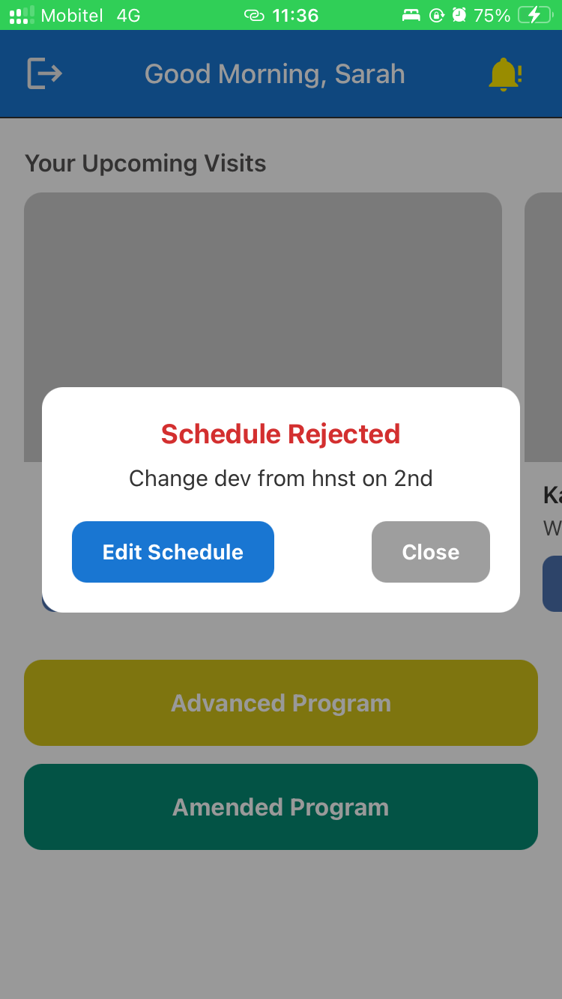
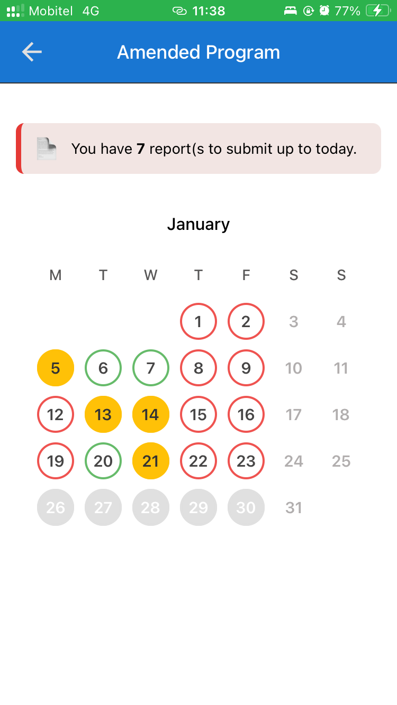
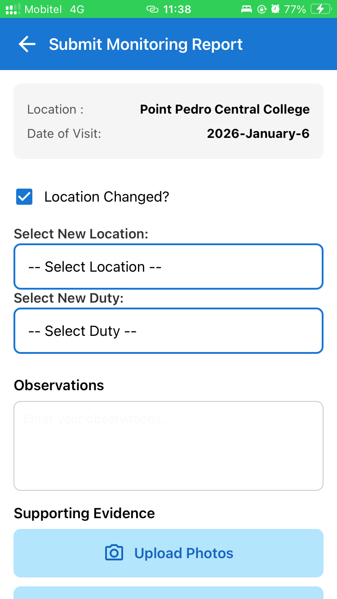
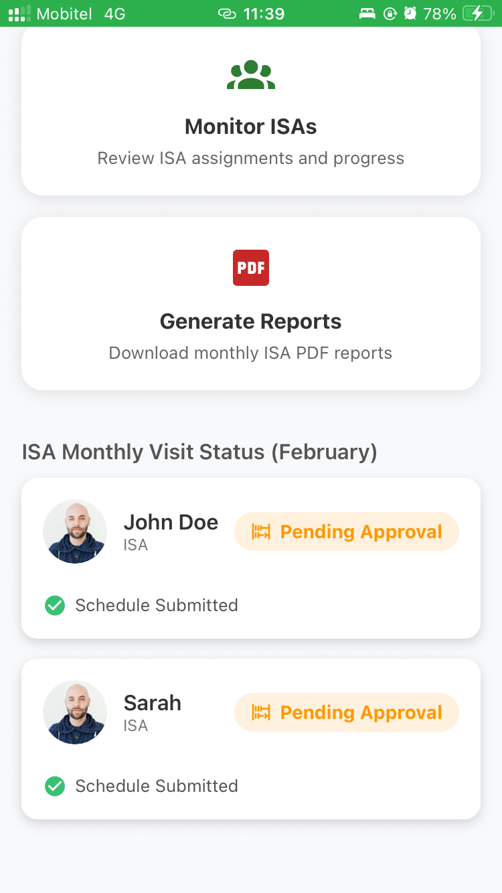
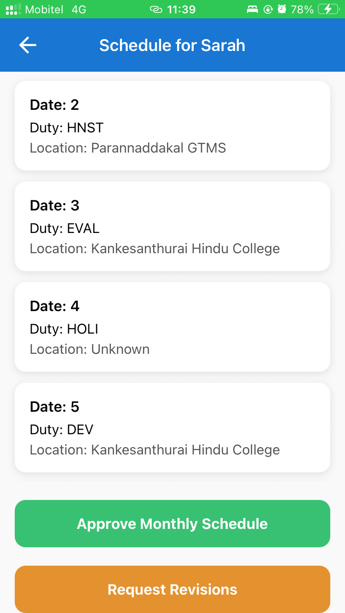
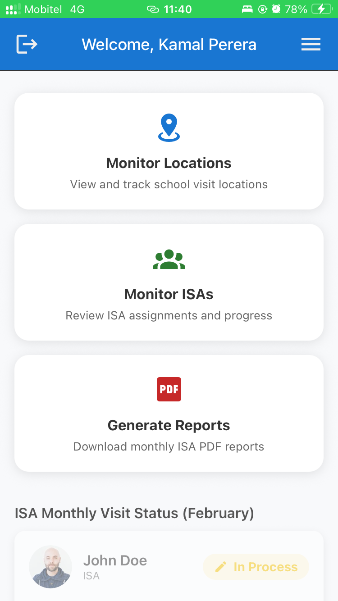
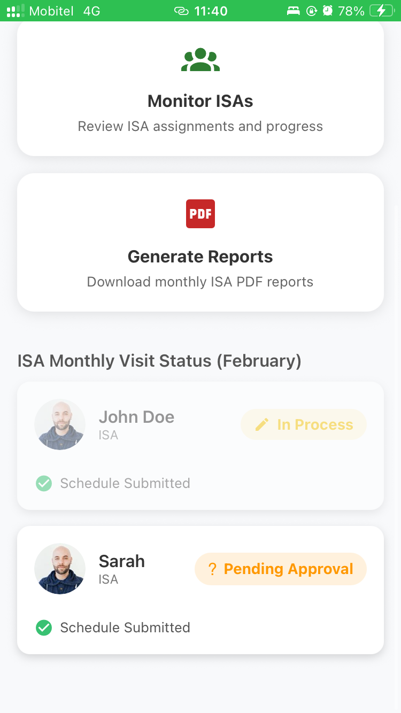
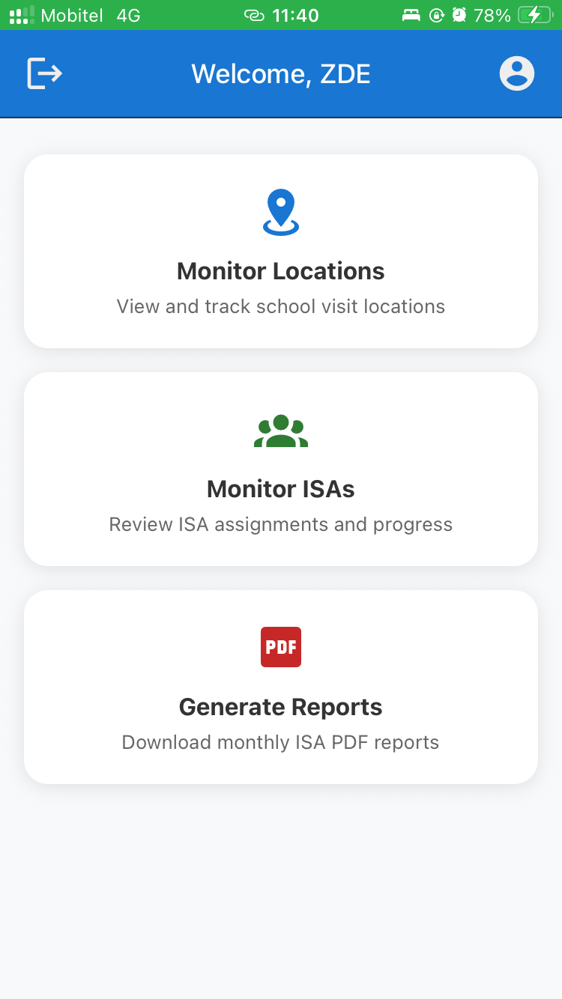

# ISA School Visit Scheduling System

A mobile-based School Visit Scheduling and Monitoring System developed for the Zonal Education Office, Vavuniya North, Sri Lanka.

The system aims to digitize school visit scheduling, reporting, approval, and monitoring processes. It provides a structured workflow for education officials to coordinate school visits and monitor submitted reports through a centralized platform.

## 📸 Application Screenshots

The following screenshots demonstrate the application's user interfaces and functionality.

<table>
  <tr>
    <td align="center" width="25%">
      
      <br/><b>Application Screen 1</b>
    </td>
    <td align="center" width="25%">
      
      <br/><b>Application Screen 2</b>
    </td>
    <td align="center" width="25%">
      
      <br/><b>Application Screen 3</b>
    </td>
    <td align="center" width="25%">
      
      <br/><b>Application Screen 4</b>
    </td>
  </tr>
  <tr>
    <td align="center">
      
      <br/><b>Application Screen 5</b>
    </td>
    <td align="center">
      
      <br/><b>Application Screen 6</b>
    </td>
    <td align="center">
      
      <br/><b>Application Screen 7</b>
    </td>
    <td align="center">
      
      <br/><b>Application Screen 8</b>
    </td>
  </tr>
  <tr>
    <td align="center">
      
      <br/><b>Application Screen 9</b>
    </td>
    <td align="center">
      
      <br/><b>Application Screen 10</b>
    </td>
    <td align="center">
      
      <br/><b>Application Screen 11</b>
    </td>
    <td align="center">
      
      <br/><b>Application Screen 12</b>
    </td>
  </tr>
  <tr>
    <td align="center">
      
      <br/><b>Application Screen 13</b>
    </td>
    <td align="center">
      
      <br/><b>Application Screen 14</b>
    </td>
    <td align="center">
      
      <br/><b>Application Screen 15</b>
    </td>
    <td align="center">
      
      <br/><b>Application Screen 16</b>
    </td>
  </tr>
</table>

## ✨ Key Features

- **School Visit Scheduling:** Manage and coordinate school visit schedules.
- **Visit Reporting:** Submit reports related to school visits.
- **Approval Workflow:** Support the review and approval process involving designated education officials.
- **Role-Based Access:** Provide interfaces and access according to assigned user roles.
- **Monitoring:** Enable education officials to monitor school visit activities.
- **Location Management:** Manage locations associated with school visits.
- **Report Generation:** Support the generation of visit-related PDF reports.
- **Authentication and Authorization:** Protect application endpoints using JWT-based authentication and role-based access controls.

## 👥 User Roles

The system includes role-specific interfaces for the following users:

- **ISA:** Manage assigned visit schedules and submit reports.
- **ADE:** Review and manage relevant school visit activities.
- **DDE:** Participate in the designated approval workflow.
- **ZDE:** Monitor school visit activities and reports.
- **Administrator:** Manage users and school visit locations.

The available actions depend on the permissions implemented for each role.

## 🛠️ Technology Stack

| Component         | Technologies                   |
| ----------------- | ------------------------------ |
| Mobile Frontend   | React Native, Expo, TypeScript |
| Backend           | Node.js, Express.js            |
| Database          | MySQL                          |
| Authentication    | JSON Web Tokens (JWT)          |
| API Communication | RESTful APIs                   |
| Deployment        | Fly.io                         |
| Version Control   | Git, GitHub                    |

## 🏗️ System Architecture

The mobile application communicates with the backend through RESTful APIs. The backend handles business logic, authentication, authorization, and database operations.

```text
React Native + Expo
        |
        | REST API Requests
        v
Node.js + Express.js
        |
        | SQL Queries
        v
     MySQL Database
```

## 📁 Project Structure

```text
ISA-School-Visit-Scheduling-System/
├── backend/
│   ├── src/
│   │   ├── config/
│   │   ├── controllers/
│   │   ├── middleware/
│   │   ├── models/
│   │   ├── routes/
│   │   └── server.js
│   ├── package.json
│   └── Dockerfile
├── frontend/
│   ├── app/
│   ├── api/
│   ├── components/
│   ├── assets/
│   └── package.json
├── database/
│   └── latestBackup.sql
├── screenshots/
└── README.md
```

## 🚀 Getting Started

### Prerequisites

- Node.js and npm
- MySQL Server
- Expo-compatible development environment
- Git

### 1. Clone the Repository

```bash
git clone <repository-url>
cd ISA-School-Visit-Scheduling-System
```

### 2. Configure the Backend

```bash
cd backend
npm install
```

Configure the required environment variables using the provided `.env.example` file. Set the database connection details and authentication secrets according to your local environment.

Start the backend using the script defined in `backend/package.json`.

### 3. Configure the Database

Create the required MySQL database and configure the backend connection settings.

If `database/latestBackup.sql` is the correct database backup for your current version, import it into your local MySQL instance before starting the application.

### 4. Configure the Frontend

Open another terminal:

```bash
cd frontend
npm install
```

Configure the API base URL in `api/axiosInstance.js` and any other API calls so that the mobile application can reach your running backend.

### 5. Start the Mobile Application

```bash
npx expo start
```

Follow the Expo terminal instructions to run the application on a compatible device or emulator.

Refer to the frontend and backend documentation for additional configuration details.

## 🔐 Security

- Store credentials and secret keys in environment variables.
- Do not commit actual `.env` files containing secrets.
- Use HTTPS when communicating with a deployed backend.
- Apply authentication and authorization checks to protected API endpoints.

## 🎓 Academic Project

**Programme:** BSc in Information Technology  
**Institution:** University of Vavuniya, Sri Lanka  
**Project:** ISA School Visit Scheduling System

## 👨‍💻 Contributors

Add the names of the project team members and their contributions here.

---

Developed to support the digital transformation of school visit scheduling, reporting, and monitoring processes.
