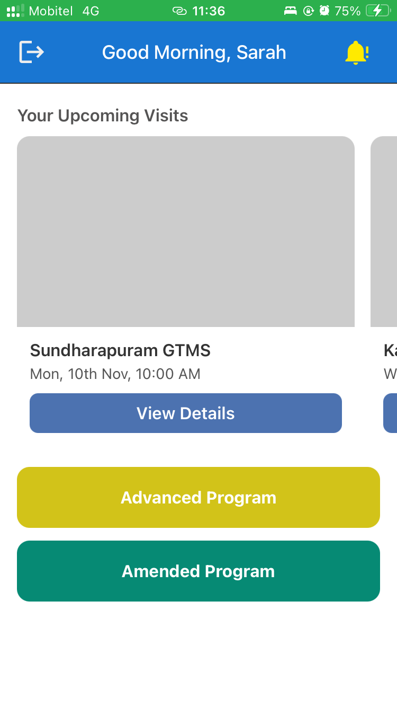
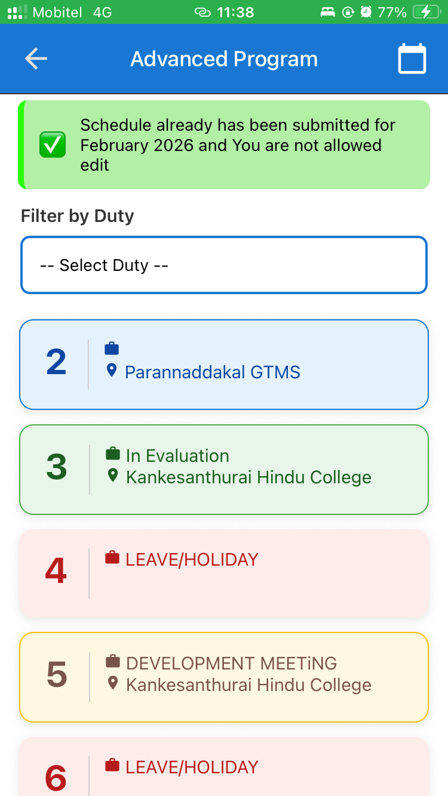
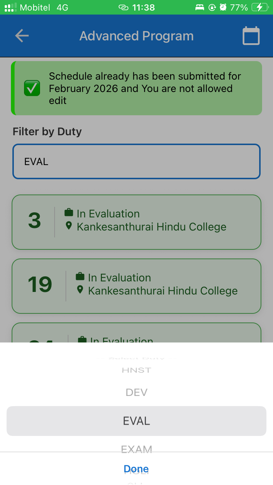
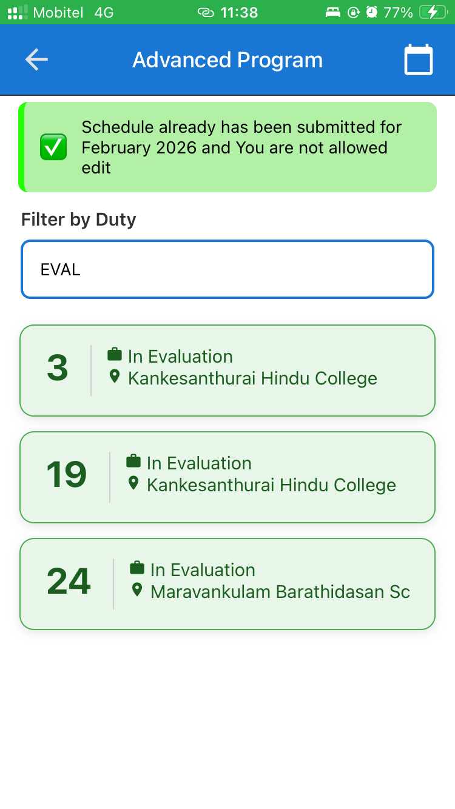
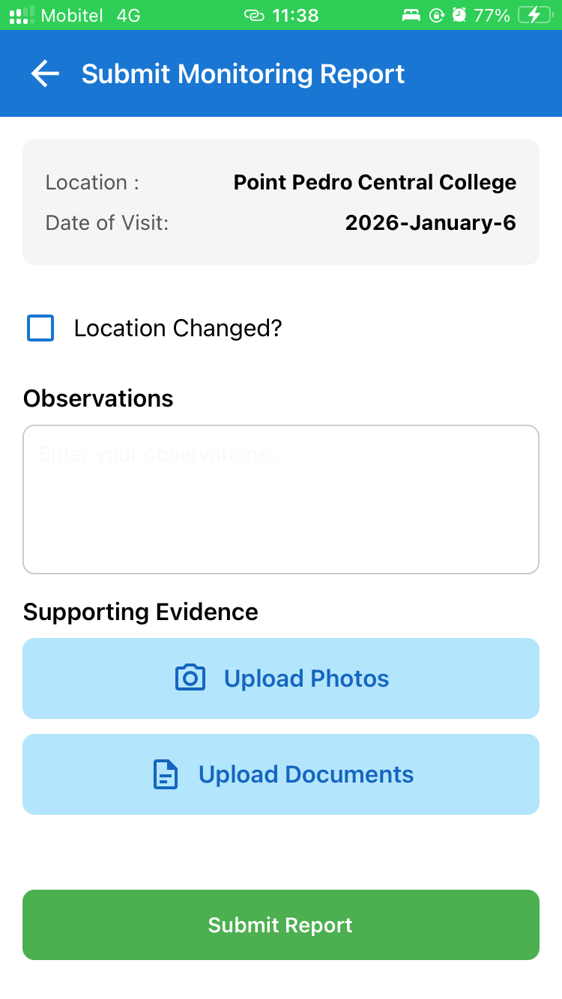
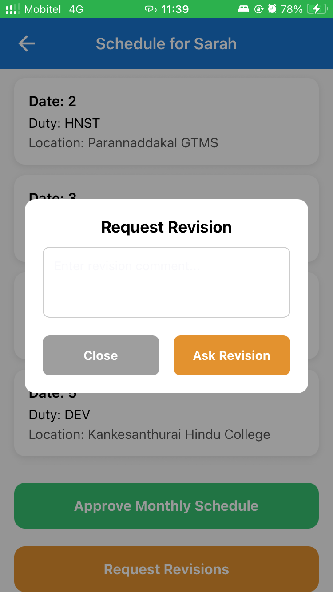
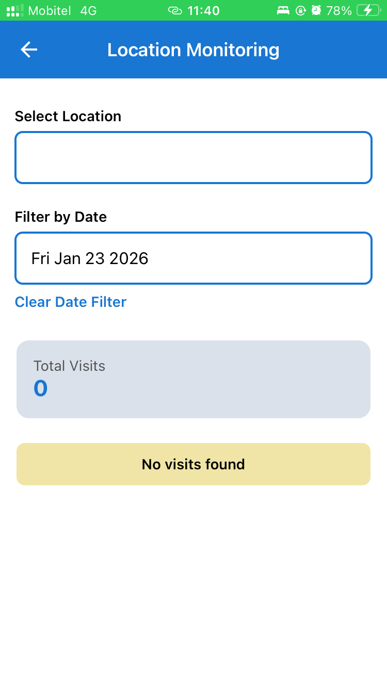
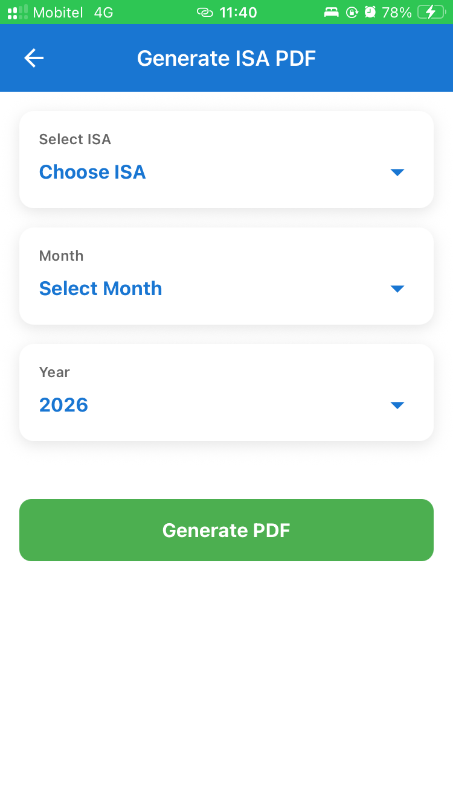

# ISA School Visit Scheduling System

A React Native mobile application for managing school visit schedules, administrative approvals, location monitoring, and visit reports within an educational administration structure.

The system provides role-based access for In-Service Advisors (ISAs), Assistant Directors of Education (ADEs), Deputy Directors of Education (DDEs), Zonal Directors of Education (ZDEs), and administrators. It is designed to replace fragmented/manual processes with a centralized workflow for scheduling and monitoring school visits.

<p align="center">
  
  
  
  
  
  
  
</p>

## Table of Contents

- [Overview](#overview)
- [Live Application](#live-application)
- [Features](#features)
- [User Roles](#user-roles)
- [Application Screenshots](#application-screenshots)
- [System Architecture](#system-architecture)
- [Technology Stack](#technology-stack)
- [API Reference](#api-reference)
- [Authentication and Authorization](#authentication-and-authorization)
- [Project Structure](#project-structure)
- [Run Locally](#run-locally)
- [Environment Variables](#environment-variables)
- [Deployment](#deployment)
- [Security Notes](#security-notes)
- [Future Enhancements](#future-enhancements)
- [Author](#author)

## Overview

School visits are an important part of educational monitoring and support. Managing visit schedules, revisions, approvals, and reports manually can make it difficult to follow the progress of requests and maintain consistent records.

The ISA School Visit Scheduling System provides a mobile interface and backend API to support these activities. ISAs can manage and submit monthly visit schedules, while authorized education officers can review schedules, approve or reject them, monitor visits by ISA or location, and generate reports.

### Project objectives

- Digitize school visit scheduling and monthly submission.
- Support role-based access for educational officers and administrators.
- Provide a structured schedule review and approval process.
- Allow schedule revision requests and show recent rejection information to ISAs.
- Support monitoring by ISA and location.
- Provide location management for authorized administrators.
- Support monitoring report submission and visit PDF generation.
- Host the backend and database online so the Android application can communicate with the deployed service.

## Live Application

| Component   | Details                                                                                                              |
| ----------- | -------------------------------------------------------------------------------------------------------------------- |
| Android APK | [Download APK](https://expo.dev/accounts/mohomedhadhi/projects/frontend/builds/12f71f1d-d7ce-4bd2-99f3-5be13deb2178) |
| Backend     | Hosted on Fly.io                                                                                                     |
| Database    | MySQL hosted on Aiven                                                                                                |
| Source code | [GitHub repository](https://github.com/hadhi419/ISA-School-Visit-Scheduling-System)                                  |

### Installing the APK

1. Open the APK sharing link on an Android device.
2. Download the APK.
3. If Android asks, allow installation from that source.
4. Install and open the application.
5. Sign in with credentials supplied by the project administrator.

## Demo Accounts

You can use the following demo accounts to explore the application's role-based functionality.

| Role  | Username / Email         | Password        |
| ----- | ------------------------ | --------------- |
| ISA   | `isa.demo@example.com`   | `DemoISA123!`   |
| ADE   | `ade.demo@example.com`   | `DemoADE123!`   |
| DDE   | `dde.demo@example.com`   | `DemoDDE123!`   |
| ZDE   | `zde.demo@example.com`   | `DemoZDE123!`   |
| Admin | `admin.demo@example.com` | `DemoAdmin123!` |

**Testing notes**

- These accounts are for demonstration purposes only.
- Please do not enter real personal or confidential information.
- Some actions may modify shared demo data.
- If login fails, the demo environment may be temporarily unavailable.

**Note:** Replace these example credentials with the actual demo accounts configured in the system before publishing this section.

## Features

### ISA features

- View the ISA dashboard and alerts.
- Manage monthly school visit entries.
- Check whether a monthly schedule can be edited.
- Submit monthly visit schedules for review.
- View advanced programs in calendar and card layouts.
- Filter advanced program cards.
- Submit monitoring reports with file attachments.
- View the latest schedule rejection information.

### ADE and DDE features

- View the administrative dashboard.
- Retrieve submitted visit schedules.
- View visit details for an ISA.
- Approve or reject schedules according to the user's role.
- Request schedule revisions through the applicable workflow.
- Monitor visits by ISA and by location.
- Access report-generation functionality.

### ZDE features

- Access the ZDE dashboard.
- View submitted schedules and visit details.
- Monitor visit information by ISA and location.
- Access report-generation functionality.
- Use the schedule approval/rejection capabilities only where implemented and authorized. In the supplied approval routes, ZDE approve/reject endpoints are commented out.

### Administrator features

- Register users through the available registration endpoint.
- Retrieve all users.
- Edit user information.
- Change passwords.
- Add and edit school/location records.

### General capabilities

- JWT authentication middleware on protected route groups.
- Role-based authorization on many protected endpoints.
- Centralized MySQL persistence.
- REST-style API communication between the mobile client and backend.
- Visit PDF generation endpoint.
- Monitoring report submission with up to five uploaded files per request, as configured by the upload middleware.

## User Roles

| Role    | Capabilities exposed by the supplied routes                                                                                                     |
| ------- | ----------------------------------------------------------------------------------------------------------------------------------------------- |
| `ISA`   | Manage and submit own monthly visits, check edit permission, delete visit entries, view latest rejection information, submit monitoring reports |
| `ADE`   | View submitted schedules and visit details, approve/reject schedules, monitor by ISA/location, access visit PDF route                           |
| `DDE`   | View submitted schedules and visit details, approve/reject schedules, monitor by ISA/location, access visit PDF route                           |
| `ZDE`   | View submitted schedules and visit details, monitor by ISA/location, access visit PDF route                                                     |
| `ADMIN` | Manage users and locations, change passwords                                                                                                    |

The exact data-level permissions (for example, whether a user can access only records in their division) depend on the controller logic as well as route middleware. The table describes access visible in the route definitions supplied for this README.

## Application Screenshots

Screenshots are stored in the [`screenshots/`](screenshots/) directory. The images below use the exact filenames in the repository.

### ISA dashboard

<p align="center">
  
  
</p>

### Advanced program scheduling

**Calendar view**

<p align="center">
  
</p>

**Card view and filters**

<p align="center">
  
  
  
</p>

### Monitoring report submission

<p align="center">
  
  
</p>

### ADE and DDE dashboard

<p align="center">
  
</p>

### Schedule review and revision request

<p align="center">
  
  
</p>

### Location monitoring

<p align="center">
  
</p>

### Report generation

<p align="center">
  
</p>

### ZDE dashboard

<p align="center">
  
</p>

## System Architecture

```text
+-----------------------------------+
|       Android Mobile Client       |
|         React Native / Expo       |
+-----------------+-----------------+
                  |
                  | HTTPS requests / REST API
                  v
+-----------------------------------+
|          Express.js API           |
|          Node.js on Fly.io        |
|                                   |
| Authentication and authorization  |
| Visits, approvals, locations      |
| Reports and PDF-related actions   |
+-----------------+-----------------+
                  |
                  | MySQL connection (TLS where configured)
                  v
+-----------------------------------+
|          Aiven MySQL              |
|      Persistent application data  |
+-----------------------------------+
```

### Architecture overview

- **Mobile client:** Presents role-specific screens and sends requests to the backend.
- **Express API:** Handles requests through route modules, controllers, authentication middleware, and role-authorization middleware.
- **MySQL:** Stores structured application data.
- **Fly.io:** Hosts the backend API.
- **Aiven:** Hosts the managed MySQL database.

## Technology Stack

| Layer                      | Technology                                          |
| -------------------------- | --------------------------------------------------- |
| Mobile application         | React Native                                        |
| Mobile development tooling | Expo, if used by the current frontend configuration |
| Backend runtime            | Node.js                                             |
| Backend framework          | Express.js                                          |
| API style                  | REST                                                |
| Authentication             | JWT-based middleware                                |
| Authorization              | Role-based middleware                               |
| Database                   | MySQL                                               |
| Backend deployment         | Fly.io                                              |
| Database hosting           | Aiven                                               |
| Version control            | Git and GitHub                                      |

Confirm the exact frontend language and Expo configuration from the project files before adding TypeScript or Expo-specific claims beyond what your application actually uses.

## API Reference

The endpoints below are based on the supplied Express router definitions. The **router-relative path** is shown because the final URL prefix depends on how each router is mounted in the main server file (for example, `app.use('/api/visits', visitRouter)`). Confirm the mount prefixes in `server.js` or `app.js` before treating the full URLs as final.

### Authentication and user management

Router-relative paths:

| Method | Path               | Purpose               | Access shown in routes                               |
| ------ | ------------------ | --------------------- | ---------------------------------------------------- |
| `POST` | `/register`        | Register a user       | No authentication middleware shown on this route     |
| `POST` | `/login`           | Authenticate a user   | No authentication middleware shown on this route     |
| `GET`  | `/allUsers`        | Retrieve all users    | Authenticated `ADMIN`                                |
| `POST` | `/editUser`        | Edit user information | Authenticated `ADMIN`                                |
| `POST` | `/change-password` | Change password       | Authenticated `ADMIN`, `ISA`, `DDE`, `ADE`, or `ZDE` |

### Schedule approvals

The approval router applies `authenticate` to all routes in the router.

| Method | Path                         | Purpose                                  | Allowed role        |
| ------ | ---------------------------- | ---------------------------------------- | ------------------- |
| `GET`  | `/`                          | Fetch submitted visit schedules          | `ZDE`, `DDE`, `ADE` |
| `GET`  | `/visitDetail/:isa_id`       | Fetch visit details for an ISA           | `ZDE`, `DDE`, `ADE` |
| `POST` | `/dde/approve/:isa_id`       | Approve a schedule through the DDE route | `DDE`               |
| `POST` | `/dde/reject/:isa_id`        | Reject a schedule through the DDE route  | `DDE`               |
| `POST` | `/ade/approve/:isa_id`       | Approve a schedule through the ADE route | `ADE`               |
| `POST` | `/ade/reject/:isa_id`        | Reject a schedule through the ADE route  | `ADE`               |
| `GET`  | `/rejections/latest/:isa_id` | Retrieve the latest rejection for an ISA | `ISA`               |

**Note:** ZDE approve/reject routes appear as commented-out code in the supplied router and are therefore not listed as active endpoints.

### Locations

The location router applies `authenticate` to all routes in the router.

| Method | Path           | Purpose         | Allowed role                        |
| ------ | -------------- | --------------- | ----------------------------------- |
| `GET`  | `/`            | Fetch locations | `ISA`, `DDE`, `ZDE`, `ADE`, `ADMIN` |
| `POST` | `/addLocation` | Add a location  | `ADMIN`                             |
| `POST` | `/edit`        | Edit a location | `ADMIN`                             |

### Monitoring reports

| Method | Path      | Purpose                                                                                  | Middleware visible in supplied router |
| ------ | --------- | ---------------------------------------------------------------------------------------- | ------------------------------------- |
| `POST` | `/submit` | Submit a monitoring report, with up to five files under the multipart field name `files` | `upload.array('files', 5)`            |

**Security note:** The supplied report router does not show `authenticate` or `authorizeRoles` middleware. Confirm whether authentication and authorization are enforced inside `submitMonitoringReport` or at a higher level before deploying this route publicly.

### Visit PDF

| Method | Path   | Purpose              | Middleware visible in supplied router                                                                         |
| ------ | ------ | -------------------- | ------------------------------------------------------------------------------------------------------------- |
| `POST` | `/pdf` | Generate a visit PDF | `authenticate` is applied to the router; the supplied route places `generateVisitPdf` before `authorizeRoles` |

**Important:** In Express, middleware order matters. Since `generateVisitPdf` is placed before `authorizeRoles`, it may generate or send a response before the role check runs. Review this route and, if the intention is to authorize the role before PDF generation, place `authorizeRoles('ISA', 'ZDE', 'DDE', 'ADE')` before the controller.

### Visits

The visits router applies `authenticate` to all routes in the router.

| Method | Path                                    | Purpose                            | Allowed role        |
| ------ | --------------------------------------- | ---------------------------------- | ------------------- |
| `POST` | `/`                                     | Create/post multiple visit entries | `ISA`               |
| `POST` | `/delete`                               | Delete a visit entry               | `ISA`               |
| `GET`  | `/month/:month/:isa_id`                 | Fetch visits for an ISA and month  | `ISA`               |
| `GET`  | `/month/:month/:isa_id/edit-permission` | Check monthly edit permission      | `ISA`               |
| `POST` | `/submit`                               | Submit monthly visits              | `ISA`               |
| `GET`  | `/isa`                                  | Monitor visits by ISA              | `ZDE`, `DDE`, `ADE` |
| `GET`  | `/isaDetails`                           | Fetch ISA details/list             | `ZDE`, `DDE`, `ADE` |
| `GET`  | `/location`                             | Monitor visits by location         | `ZDE`, `DDE`, `ADE` |

### API conventions

- Replace `:isa_id` with the relevant ISA identifier.
- Protected endpoints require a valid authenticated request according to the configured authentication middleware.
- Role restrictions are enforced by `authorizeRoles` where it appears in the route definitions.
- Request bodies, response schemas, validation rules, and status codes are controller-specific and should be documented from the controller implementations.
- The final API URL is the router mount prefix plus the router-relative path.

## Authentication and Authorization

The backend imports JWT authentication middleware (`authenticate`) and role-based authorization middleware (`authorizeRoles`).

In the supplied route definitions:

1. Some router groups apply authentication to every route using `router.use(authenticate)`.
2. Selected endpoints add role restrictions.
3. Registration and login are public at the router level.
4. The report route needs a security review because authentication middleware is not visible in the provided router.
5. The PDF route needs a middleware-order review so authorization happens before PDF generation.

Always enforce access control on the backend. Hiding a button or screen in the mobile app is not a substitute for API authorization.

## Project Structure

The exact structure should match the repository. Based on the supplied imports, the backend includes route modules, controllers, and middleware similar to the following:

```text
ISA-School-Visit-Scheduling-System/
├── screenshots/
│   ├── ISA_Dashboard.PNG
│   ├── ISA_Advanced_Program_Calander_View.PNG
│   ├── ISA_Submit_Report_screen_1.PNG
│   ├── ADE_DDE_Dashboard.PNG
│   ├── ADE_DDE_Schedule_Review.PNG
│   ├── ADE_DDE_ZDE_Location_Monitoring.PNG
│   └── ZDE_Dashboard.PNG
├── backend/
│   ├── controllers/
│   │   ├── approvalController.js
│   │   ├── authController.js
│   │   ├── locationController.js
│   │   ├── reportController.js
│   │   ├── visitController.js
│   │   └── visitPdfController.js
│   ├── middleware/
│   │   ├── authMiddleware.js
│   │   ├── roleMiddleware.js
│   │   └── upload.js
│   └── package.json
├── [frontend directory]
└── README.md
```

The frontend directory and some backend filenames may differ from this illustrative structure; keep the names synchronized with the actual repository.

## Run Locally

### Prerequisites

- Git
- Node.js and npm
- MySQL access
- Android device or emulator for the mobile client
- Expo CLI tooling if required by the frontend project

### 1. Clone the repository

```bash
git clone https://github.com/hadhi419/ISA-School-Visit-Scheduling-System.git
cd ISA-School-Visit-Scheduling-System
```

### 2. Install backend dependencies

```bash
cd backend
npm install
```

Check `backend/package.json` for the actual startup scripts before running the server.

```bash
npm start
```

If the project defines a development script, use `npm run dev` instead.

### 3. Configure the backend environment

Create a local `.env` file using the variable names expected by your source code. An illustrative template is shown below; these names are not guaranteed to match the current implementation.

```env
PORT=5000
NODE_ENV=development

DB_HOST=your_mysql_host
DB_PORT=your_mysql_port
DB_USER=your_mysql_user
DB_PASSWORD=your_mysql_password
DB_NAME=your_database_name

JWT_SECRET=replace_with_a_strong_secret
```

If using Aiven MySQL, configure the TLS/SSL options and CA certificate required by your database connection settings.

### 4. Start the frontend

Open a separate terminal, navigate to the actual mobile frontend directory, and install its dependencies.

```bash
npm install
```

Then run the start script defined in that directory's `package.json`. For an Expo project, this is commonly:

```bash
npx expo start
```

Configure the mobile app's API base URL for your local backend or deployed Fly.io service. For an Android emulator, `localhost` usually points to the emulator itself, not your development computer.

## Environment Variables

The actual variable names must be confirmed from the backend source code. Typical settings may include:

| Variable                              | Purpose                                    |
| ------------------------------------- | ------------------------------------------ |
| `PORT`                                | Port used by the Express server            |
| Database host/port/user/password/name | MySQL connection configuration             |
| JWT secret or key configuration       | Signing/verifying authentication tokens    |
| Database TLS settings                 | Secure connection to the managed database  |
| API base URL (frontend)               | Backend URL used by the mobile application |

Never commit real `.env` files, credentials, private keys, or database certificates that should remain confidential. Add local secret files to `.gitignore`.

## Deployment

### Backend — Fly.io

The backend is hosted on Fly.io. Deployment configuration should provide the required runtime settings and secrets, expose the correct service port, and allow the application to connect to Aiven MySQL.

After deployment, verify that:

- the application starts successfully;
- the database connection works;
- protected endpoints require authentication;
- role restrictions are enforced;
- the mobile application points to the correct HTTPS API URL.

### Database — Aiven MySQL

Aiven hosts the MySQL database. Keep database credentials in backend environment variables or deployment secrets. Use the connection and TLS settings recommended for the configured Aiven service.

### Android APK

Add the actual APK link in the Live Application section. If the APK is hosted on Google Drive, test the link in a private/incognito browser or with a separate account to ensure the intended audience can access it.

## Security Notes

- Keep `.env` files and credentials out of Git.
- Use HTTPS for communication with the deployed API.
- Use TLS for database connections when required by the managed database configuration.
- Validate input in controllers and use parameterized database queries.
- Enforce authorization on the backend for every protected operation.
- Review the report submission route's authentication and authorization.
- Ensure PDF generation checks authorization before processing the request.
- Avoid putting private keys, passwords, or sensitive personal data in screenshots or sample requests.
- Rotate any credential that has accidentally been exposed.

## Future Enhancements

Potential future improvements include push notifications for approval status changes, more detailed audit history, automated API tests, calendar integrations, enhanced analytics, and offline-friendly mobile features. These are ideas for future work, not claims that they are already implemented.

## Author

**M. H. M. Hadhi**

Information Technology Undergraduate

- GitHub: [@hadhi419](https://github.com/hadhi419)
- Repository: [ISA School Visit Scheduling System](https://github.com/hadhi419/ISA-School-Visit-Scheduling-System)

Developed as an academic project to support the digital management of school visit scheduling, approvals, monitoring, and reporting.

---

If you find this project useful, consider starring the repository.
